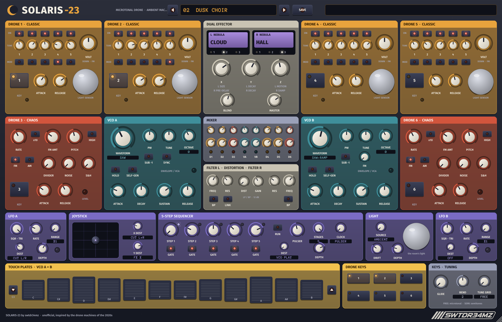

# SOLARIS-23

A microtonal drone and ambient machine as a plugin: a **VST3** and a **standalone app** for Windows (the Mac build is
ready in the workflow), and the same engine on **Akai MPC** standalone hardware. By **swtdr34mz**.



Eight voices into a stereo mixer, a dual 12 dB filter, a stereo distortion and a dual effector:

- **DRONE 1, 2, 4, 5 (CLASSIC):** five free-running saw oscillators each (1–2 low, 3 middle, 4–5 high), each with
  its own TUNE (no semitone grid: tune chords, clusters, beatings), on/off and MOD (the light sensor bends its pitch).
  VOLT transposes all five down; past the middle they frequency-modulate each other. ATTACK and RELEASE, opened by
  the drone KEY.
- **DRONE 3, 6 (CHAOS):** a square modulator (RATE, x1/x10) and a Schmitt-trigger tone (PITCH, LOW/HIGH), FM and/or
  AM, a DIVIDER, NOISE into the tone, a S&H of the noise: sirens, birds, surf, wind.
- **VCO A, B:** morphing waveform (sine – triangle – saw – ramp – square – pulse), PW, TUNE (an octave), OCTAVE, SUB,
  an ADSR each (HOLD: always open; SELF-GEN: the envelope loops like an LFO), A synced to B, B's FM from A. Played by
  the touch plates and MIDI notes (both VCOs the same note), GLIDE, BEND.
- **Modulation:** LFO A and B (square to triangle, x1/x6/x10), the joystick (X, Y), a 5-step sequencer (GATE per
  step, 3/4/5 STAGES, its own PULSER or the host's tempo, VCO PLAY plays the VCOs), the light sensor (the room's
  light drifting, or an LFO or the sequencer). Each source has a DEST: either filter, both, both opposed, the VCOs'
  pitch, PW, wave or FM, the chaos voices, the drones' pitch, the effector's X, Y, Z or BLEND.
- **Filter:** two 12 dB filters (Polivoks-style: the integrators saturate, the lows stay with the resonance), LP or
  BP each, LINK (the left's modulation moves both). **Distortion:** DIST (its share) and GAIN.
- **Dual effector:** 8 cartridges of 3 programs, one program on the left, one on the right; X, Y, Z and BLEND
  shared, as on the instrument:

  | cartridge | 1 | 2 | 3 |
  |---|---|---|---|
  | NEBULA | SHIMMER | CLOUD | HALL |
  | ORBIT | ECHOVERB | TAPE | PITCHDLY |
  | PULSAR | TREMOLO | CHORUS | PHASER |
  | COMET | AUTOWAH | RESONATR | FORMANT |
  | GRAVITY | OCTAVER | HARMONZR | FREEZE |
  | VOID | BLACKHOL | GRAINS | SPACEDLY |
  | AURORA | RINGMOD | S&H RING | FOLD |
  | DUST | CRUSH | VINYL | RADIO |

- **TUNE GRID:** FREE (microtonal, as the instrument) or SEMI (every drone oscillator on the nearest semitone).
- **16 programs**, and your own (SAVE: files in `Documents/SOLARIS-23/Presets`).

Unofficial: inspired by the analogue drone machines of the 2020s; not made, endorsed or supported by any of their
makers, and no part of their designs, names or panels.

## Download

[Actions](https://github.com/swtdr34mz-afk/SOLARIS-23/actions) → the newest green run → **Artifacts** at the bottom:
`SOLARIS23-Windows` (VST3 + app) or `SOLARIS23-MPC` (a GitHub sign-in is needed for artifacts). A release (a tag
`v0.1.0` and so on) carries the same zips under [Releases](https://github.com/swtdr34mz-afk/SOLARIS-23/releases).

## Installieren (kurz auf Deutsch)

**Windows (Cubase):**
1. Zip entpacken.
2. Den Ordner `SOLARIS-23.vst3` nach `C:\Program Files\Common Files\VST3\` kopieren.
3. Cubase starten (oder *Studio → VST-PlugIn-Manager → Aktualisieren*). SOLARIS-23 steht unter den Instrumenten,
   Hersteller swtdr34mz.
4. `SOLARIS-23.exe` ist die Standalone-App. Audio- und MIDI-Gerät stellt man unter *Options* ein.

Windows SmartScreen kann beim ersten Start der App warnen (sie ist nicht signiert): *Weitere Informationen →
Trotzdem ausführen*.

**MPC (MPC XL, Live III und die 32-bit-MPCs):**
1. MPC OS **3.10.1 oder neuer**. Auf der MPC: **Preferences → Enhancements (Beta) → Enable Enhancements** und
   **External Plugin Support** einschalten.
2. Den Ordner **`swtdr34mz - VST - SOLARIS-23`** (aus `SOLARIS23-MPC.zip`) auf einen USB-Stick, eine SD-Karte oder
   das interne Laufwerk kopieren, in einen Ordner **`VST2 Plugins`** ganz oben auf dem Laufwerk.
3. Die MPC neu starten; SOLARIS-23 steht bei den Plugin-Instrumenten (swtdr34mz).

Auf der MPC: die Funktionstasten **DRONES** (noch mal drücken: DRONE 4/5), **CHAOS**, **VCO**, **MOD** (noch mal:
SEQ/KEYS), **MIX/FX**; die 16 Q-Links drehen auf jeder Seite die vier Reihen. Die Pads spielen die VCOs, die
Drone-Tasten sitzen auf SEQ/KEYS (und in jedem Drone-Feld).

## In the plugin

- **Every parameter** (194) is a host parameter: automatable, saved with the project. The order and the ids are
  permanent (`dsp/params_list.inc`, made by `tools/gen_params.py`; new ones only at the end).
- **MIDI in:** notes (the VCOs), velocity, pitch bend (BEND), CC 1 (more of the joystick's Y destination),
  CC 120/123. The touch plates on the panel play the same; their arrows choose the octave.
- **The host's tempo** clocks the sequencer when its CLOCK is a note value; while the host plays, it locks to its
  position.
- **The panel:** drag a knob (SHIFT: fine), double-click for its default, right-click a choice for its list. Click a
  cartridge for all 24 programs, its lamps 1-2-3 for the cartridge's programs. The joystick: drag, double-click to
  centre. The window's corner sizes it (kept with the project).

## The engine

`dsp/` (C++17, no dependencies): `engine.cpp` (the voices, the modulation, the mixer, the filter, the distortion),
`fx.cpp` (the 24 effect programs), `params.cpp`, `presets.cpp`. It runs on a grid of 16 samples, every time in
seconds, so it sounds the same at any sample rate and any buffer size. `tests/engine_tests.cpp` checks every program
at three rates, every buffer size bit for bit, every parameter swept, every effect at its ends, all at once at full,
and the CPU (about 2 % of a core per instance on a desktop).

## Build

CMake 3.22 and a C++17 compiler (Visual Studio 2022, Xcode). JUCE 8.0.9 is fetched by CMake.

```
cmake -B build -DCMAKE_BUILD_TYPE=Release
cmake --build build --config Release
```

The engine's tests alone (no JUCE): `cmake -S tests -B build-tests && cmake --build build-tests && build-tests/engine_tests`
(`engine_tests bench` for the CPU, `engine_tests render <program> <seconds> <out.wav>` to listen).

The MPC: `python3 mpc/build.py --sdk /path/to/mpc-plugin-builder-sdk` (see `mpc/`). Its skin is drawn with the VST's
own code: `mpc/skin/` (only when the panel changes; the result, `mpc/plugin/skins/`, is in the repository).

GitHub Actions (`.github/workflows/build.yml`) runs the engine's tests, builds the MPC plugin (Akai's SDK, pinned)
and checks it with its validator and `mpc/test/mpc_host_test.cpp`, builds Windows and checks the VST3 with pluginval.

## Licence

The SOLARIS-23 code is under the [Mozilla Public License 2.0](LICENSE). The plugin is built with
[JUCE](https://juce.com) 8, used under the AGPLv3 (JUCE's open-source licence), so the plugin binaries are distributed
under the AGPLv3 with this source. The fonts are Fira Sans and Anonymous Pro (SIL OFL, `fonts/`). VST is a trademark of
Steinberg Media Technologies GmbH.
